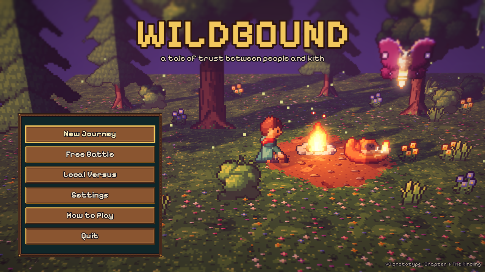
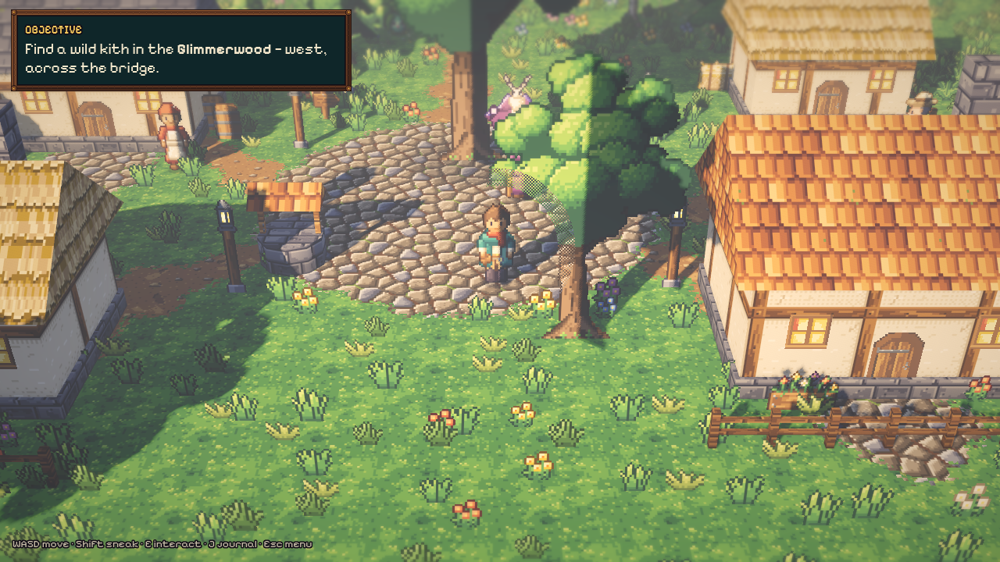
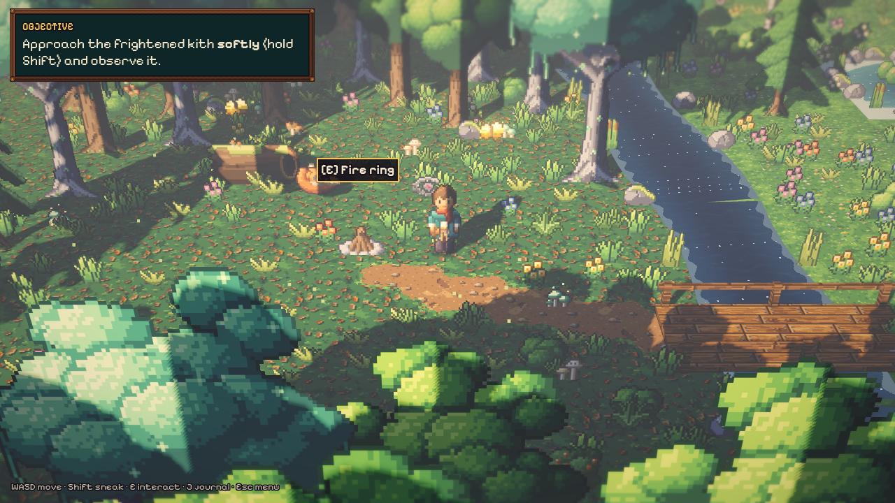
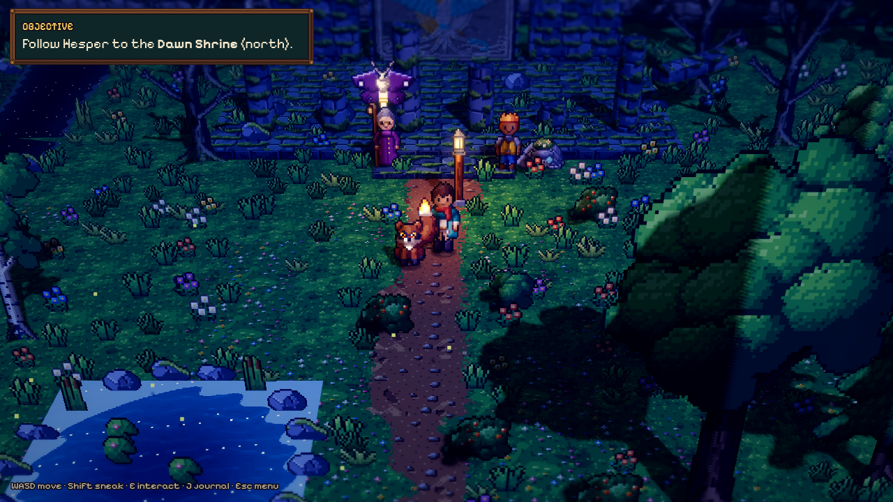
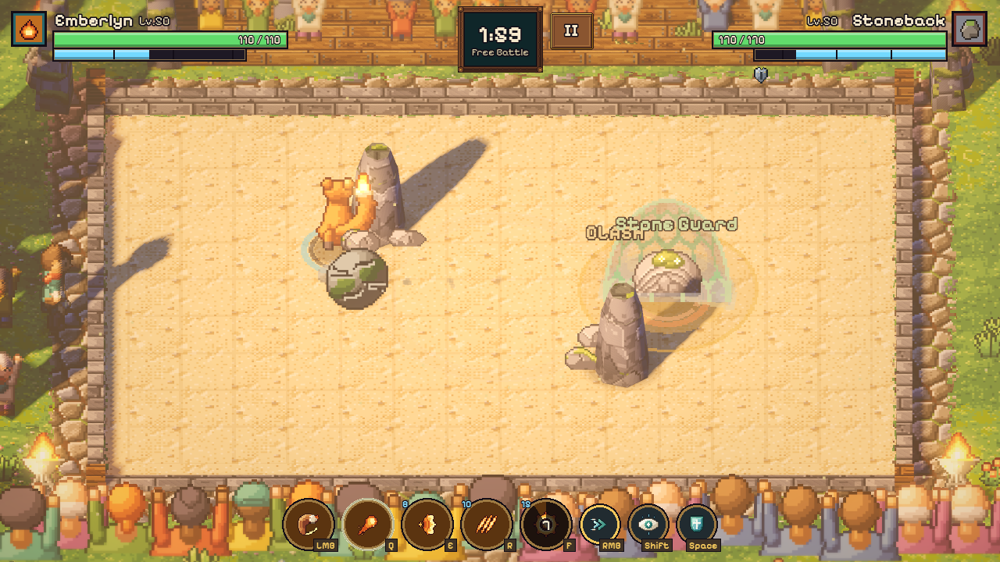

# Wildbound (working title)

*A tale of trust between people and kith.*

Wildbound is an original HD-2D creature-collecting action RPG prototype. You
explore a pixel-art valley rendered in 3D with tilt-shift light. You befriend
wild creatures called **kith** by earning their trust instead of catching
them. Then you fight alongside them in fast, readable real-time arena duels.



This is **v0**: a proof of concept to share with friends and see whether the
idea is fun. It contains:

- **The tutorial and Chapter 1, "The Kindling"** (about 15–25 minutes).
  - Wake up in Mossford.
  - Meet Warden Hesper and your rival Corin.
  - Track a frightened Emberlyn through the Glimmerwood and win its trust at a campfire.
  - Learn to fight in the training yard.
  - Duel Corin's Stoneback at the Ringstones.
  - Follow the tremor to the Dawn Shrine.
- **Free Battle**: any kith against an AI at four difficulty levels, with normalized ranked stats.
- **Dash Training**: the training-yard tutorial on its own, to learn drag-to-dash.
- **Local Versus**: two players on one keyboard, or with gamepads.

| | |
|---|---|
|  |  |
|  |  |

## How the arena plays

Fights are 1v1, top-down and real-time, inspired mechanically by Flash-era
arena games like Nindou. No code or assets come from them.

- The arena is a **board of cells**, and creatures never walk: every move is a
  **dash**. Click (or touch) and drag along a row or column, then release; the
  longer the drag, the more cells you cross. Every dash costs stamina.
- Dash *through* a foe to **ram** it: damage, a short daze and a freeze-frame
  impact. A rammed kith is protected for a moment afterwards, so rams never chain.
- **Aim** abilities with the mouse, right stick or touch.
- **Stamina** comes back only while you hold **Focus**. Focusing roots you in place, so every recovery is a gamble.
- **Basic attack** plus **four specials**, each with readable startup, active and recovery frames, and a telegraph.
- **Guard** with a perfect-guard window. Guards can be broken, and projectiles clash.
- Hits have hitstop, knockback, screen shake, hit flashes, damage numbers and layered sound.

The full design is in [`docs/`](docs/README.md): story, characters, kith,
combat frame data, progression, architecture and roadmap.

## Controls

| Action | Keyboard + mouse | Gamepad | Touch |
|---|---|---|---|
| Dash (the only way to move in battle) | Drag along a row or column and release (longer drag = more cells), or hold W/A/S/D and release | Hold the D-pad / left stick and release | Drag on the arena and release |
| Cancel a dash | Drag back to the start, or right click | Guard or Focus | Drag back to the start |
| Aim | Mouse | Right stick | Drag an ability button |
| Basic attack | Click (or J) | RT | Tap the arena, or the attack button |
| Specials | Q / E / R / F | A / B / X / Y | Ability buttons (tap to auto-aim) |
| Guard | Hold Space or the right mouse button | LB | Guard button |
| Focus (regain stamina) | Hold Shift | LT | Press and hold still on the arena, or the Focus button |
| Walk (exploring) | WASD | Left stick | Left thumb |
| Talk / interact | E or Enter | A | Tap |
| Sneak (exploring) | Hold Shift | | |
| Journal | J or Tab | | |
| Pause / menu | Esc | Start | Pause button |
| Show hitboxes | F3 | | |

While you drag, the arena shows the lane of cells the dash will cross, where
you'll land, what it costs, and **RAM!** over a foe you'll dash through.

In Local Versus, player 2 uses:

- arrow keys to charge dashes (hold, then release)
- `.` or `/` to attack
- `;` `'` `[` `]` for specials
- Right Ctrl to guard and Right Shift to focus

Gamepads work for both players.

## Play it / share it

**Web (easiest for friends).** You can host the web build in any of these ways:

- **Vercel**: import this GitHub repository as a new project and deploy. No
  settings are needed: `vercel.json` tells Vercel there is no build step and
  to serve `public/`, the ready-built web version committed with the code.
  `tools/export.sh web` refreshes `public/`; commit and push it to redeploy.
- **itch.io**: create a project and set *Kind of project* to **HTML**. Upload
  `build/dist/wildbound-web.zip` and tick *This file will be played in the
  browser*. Use a 1280×720 viewport with fullscreen enabled. No
  SharedArrayBuffer option is needed.
- **GitHub Pages**: the CI workflow (`.github/workflows/ci.yml`) runs the tests
  and builds the web version on every push. To also deploy it from the default
  branch, enable *Settings → Pages → Source: GitHub Actions* and add the
  repository variable `DEPLOY_PAGES` = `true`.
- **Any static web server**: serve the files in `public/` (or `build/web-dist/`).

The web build is about 15 MB. The engine and game data are gzipped and
decompressed in the browser. It needs a desktop or mobile browser with
WebGL 2; recent Chrome, Edge, Firefox and Safari 16.4+ all work. On phones,
play in landscape.

**Desktop.** `tools/export.sh` writes these files to `build/dist/`:

- `Wildbound-windows.zip`: a single `.exe`.
- `Wildbound-linux.zip`.
- `Wildbound-macos.zip`: a universal build with an ad-hoc signature. On first
  launch, right-click the app and choose *Open*.

To get CI builds for all platforms, push a `v*` tag or run the workflow
manually with *desktop* ticked.

Saves are stored locally. On desktop they live in the Godot user folder; on
the web they live in the browser's IndexedDB.

## Building from source

1. Install [Godot 4.7.2](https://godotengine.org/download) (standard build, not .NET)
   and its export templates. Open the folder in the editor or use the command line:

   ```sh
   godot --path .            # play from the title screen
   tools/run_tests.sh        # run the headless test suite
   tools/run_tests.sh dash   # run only tests whose name contains "dash"
   tools/export.sh web       # web build -> build/web-dist + build/dist/wildbound-web.zip
   tools/export.sh           # web, windows, linux, macos
   ```

   Set `GODOT=/path/to/godot` if the binary isn't on your `PATH`.

2. For a quick look while developing, use these command-line flags (pass them after `--`):

   | Flag | Applies to | What it does |
   |---|---|---|
   | `--step=<step>` | `scenes/world/mossford.tscn` | Fast-forwards the story. `<step>` is one of `find_kith`, `forest`, `fire`, `befriend`, `training`, `duel`, `ending`, `complete`. |
   | `--at=x,z` | `scenes/world/mossford.tscn` | Places the explorer at that position. |
   | `--demo` | `scenes/combat/battle.tscn` | Runs an AI-vs-AI battle. |
   | `--shot=<file.png>` | title, world and battle scenes | Saves a screenshot and quits. |

The test suite has 89 tests, including an end-to-end Chapter 1 playthrough
test. It covers the following:

- movement and dashing
- the dash-through daze
- stamina and Focus
- the state machine and stun limits
- abilities
- KOs and match flow
- progression
- input encoding
- AI
- save and load
- HUD scaling
- that every script and shader compiles

An AI-vs-AI balance harness lives in `tests/tools/balance_sim.gd`.

## Project layout

```
scripts/combat/        deterministic 60 Hz battle simulation (no nodes), systems,
                       ability components, AI, and the HD-2D battle view
scripts/creatures/     data definitions: kith, abilities, profiles, variants
scripts/progression/   leveling, mastery, rulesets, stat calculation
scripts/world/         Mossford region builder, explorer, NPCs, Chapter 1 director
scripts/networking/    input sources and transport abstraction (local today)
scripts/ui/            HUD, touch controls, dialogue, menus, journal
resources/             .tres data for kith, abilities, statuses; dialogue JSON
shaders/               pixel sprites, triplanar world, terrain, water, post FX
assets/                generated sprites, environments, VFX, UI, audio, font
tools/                 asset generators (sprite/env/audio forges), test and export scripts
tests/                 unit + integration tests and the balance harness
docs/                  game design and technical docs
```

## Originality and credits

Wildbound is an original project. Every character, creature, name, sprite,
texture, effect, sound and piece of music was made for it. The audio and most
of the art were procedurally generated by the scripts in `tools/sprite_forge`,
`tools/env_forge` and `tools/audio_forge`; the HD character and kith sprites,
the dialogue portraits and the loading key art are image-model paintings of
our own designs, rebuilt as pixel art by `tools/art_forge`, with a provenance
record for each. It does not use any characters,
names, artwork, sounds or code from Pokémon, Nindou or any other game.

- Engine: [Godot 4.7](https://godotengine.org) (MIT).
- Font: [Pixelify Sans](https://fonts.google.com/specimen/Pixelify+Sans), SIL Open Font License.

## Status

This is a prototype. It has these limits:

- **Performance:** the build has only been run in a container with software
  rendering. That proves it works, not that it's fast, and real-GPU
  performance hasn't been measured.
- **Multiplayer:** local only. Battles already run on a fixed-tick simulation
  driven by serialized input commands, ready for an authoritative server later.
  No online play has been built or load-tested.
- **Server authority:** in future online modes the server will own inventory,
  XP, damage and match results; clients will never be trusted with them.

See [`docs/roadmap.md`](docs/roadmap.md) for what's next.
